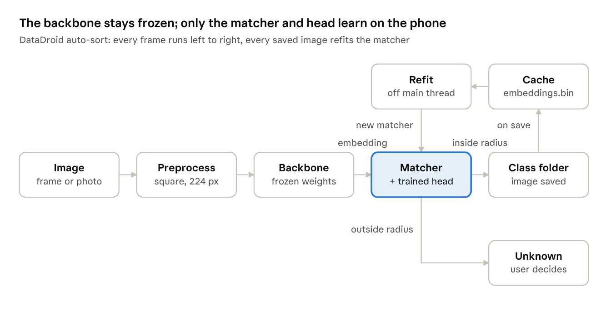

# Personalized On-Device AI for Mobile

Nov 15, 2026 · Tawhid Monowar

*How DataDroid learns a user's own image classes on the phone, with a frozen backbone, a training-free matcher and a linear layer trained on-device, in Kotlin Multiplatform.*

Most on-device AI ships a fixed model. It recognises the 1,000 things its authors chose, and it recognises the same things for everyone. A personalized model is different: it has to learn *your* categories, from *your* examples, and it has to start working after the first few of them.

The usual answer is to upload the data, fine-tune in the cloud and push a model back. That costs a backend, a round trip and the user's privacy. I wanted to know how far a phone gets alone.

This post walks through the answer I built into [DataDroid](https://github.com/tawhidmonowar/DataDroid), an open-source Kotlin Multiplatform app for Android and iOS that builds image classification datasets. Its auto-sort feature learns the classes a user invents, from the images they capture, and files each new image into the right class. No image leaves the device, and there is no server.

The recipe has three parts, and each one is small:

1. A **frozen pretrained backbone** turns every image into an embedding vector.
2. A **training-free matcher** compares embeddings, so a class works from its first image.
3. A **linear head trained on the device** takes over once each class has ten distinct images.

I'll show the code for each part, the benchmark numbers behind the design choices, and the mobile engineering that keeps it responsive at five camera frames a second.



Every frame runs left to right through the frozen backbone. Each saved image loops back through the cache and a background refit, so the next frame meets a matcher that already knows it.

## The problem: a classifier for classes that don't exist yet

DataDroid turns a phone into a dataset studio. You create a dataset, add classes such as `mug` and `pen`, fill them from the camera, and export a zip of class folders that training tools read directly.

The slow part is labelling. Choose a class, shoot, choose the next class, shoot again. Forget one switch and a run of images is silently mislabelled. Auto-sort removes the switch: you just shoot, and the app decides where each image goes.

That sounds like ordinary image classification. Four constraints make it a different problem:

- **The classes are the user's.** Nobody can pretrain for "my left shoe" against "my right shoe". The labels exist only on this phone.
- **Classes are tiny and change constantly.** A new class may hold one image. The model must be useful then, and again one second later when it holds six.
- **The camera records bursts.** Holding the shutter saves about five frames a second. A two-second hold adds ten near-identical images that can drown out everything else in the class.
- **Some images belong nowhere.** Users point the camera at things that have no class yet. The app has to say "none of these" instead of guessing.

A conventional fine-tuning loop fails the second constraint straight away. Retraining a network after every shutter press is too slow, and with five images it would overfit anyway. So the design question becomes: what is the smallest amount of learning that still personalizes?

## Architecture: shared intelligence, thin runtimes

DataDroid is one Kotlin Multiplatform `shared` module with Compose Multiplatform UI. About 87% of its Kotlin is in `commonMain`: roughly 9,600 lines, against 570 in `androidMain` and 800 in `iosMain`.

The split that matters for on-device AI is where the model code sits:

- **Shared (`commonMain`)**: input tensor preprocessing, the embedding cache, the matcher, the trained head, the evaluation harness, and all the coroutine plumbing around them.
- **Android (`androidMain`)**: a 34-line LiteRT wrapper, CameraX, and the image decoder.
- **iOS (`iosMain`)**: a 79-line wrapper over the TensorFlow Lite C API through cinterop, AVFoundation, and the image decoder.

The platform code only answers one question: given 150,528 floats, what does the network output? Everything that makes the feature *personal* is pure Kotlin with no platform dependency. Both platforms therefore sort images with identical logic, and the same `commonTest` suite checks it on the JVM and on the iOS simulator in CI.

The seam is a three-line interface:

```kotlin
/** Frozen pretrained feature extractor. Implementations are not required to be thread-safe. */
interface Backbone : AutoCloseable {
    fun embed(input: FloatArray): FloatArray
}

fun interface BackboneLoader {
    suspend fun load(modelBytes: ByteArray): Backbone
}
```

Koin provides the loader per platform. Everything above it, from `FeatureExtractor` to the view model, is shared and takes the interface.

This has a second benefit that I didn't plan for: the learning code is testable without a model file. Tests pass a fake `Backbone` that returns each image's mean colour, and the matcher tests work on random vectors.

## Part 1: a frozen backbone turns pixels into vectors

A network pretrained on millions of images has already learned edges, textures and shapes. Cut off its final classification layer and what remains maps any image to a vector, an *embedding*, in which similar-looking images land close together. The backbone is frozen: the phone only runs it and never updates its weights.

That single decision removes most of the cost of personalization. The expensive, general knowledge ships in the app. The phone only has to learn how the user's classes are arranged in a space that already exists.

### One input contract for every model

Each image is decoded with EXIF orientation applied, centre-cropped to a square and scaled to 224x224. Decoding is platform code. The tensor conversion is shared, so both platforms normalise pixels in exactly the same way:

```kotlin
/** Single source of truth for backbone input normalization on every platform. */
fun RgbImage.toInputTensor(): FloatArray {
    val tensor = FloatArray(width * height * 3)
    for (i in pixels.indices) {
        val argb = pixels[i]
        tensor[i * 3] = ((argb shr 16) and 0xFF) / 255f
        tensor[i * 3 + 1] = ((argb shr 8) and 0xFF) / 255f
        tensor[i * 3 + 2] = (argb and 0xFF) / 255f
    }
    return tensor
}
```

Every bundled model takes NHWC RGB in \[0, 1\]. If a model needs anything else, such as ImageNet mean and standard deviation, that normalisation is baked into its graph at export time. The app never branches on which model is loaded.

### Android: LiteRT in 34 lines

```kotlin
class LiteRtBackbone(modelBytes: ByteArray, numThreads: Int = 4) : Backbone {
    private val interpreter = Interpreter(
        ByteBuffer.allocateDirect(modelBytes.size).order(ByteOrder.nativeOrder()).apply {
            put(modelBytes)
            rewind()
        },
        Interpreter.Options().setNumThreads(numThreads),
    )
    private val inputBuffer = ByteBuffer.allocateDirect(interpreter.getInputTensor(0).numBytes())
        .order(ByteOrder.nativeOrder())
    private val embeddingSize = interpreter.getOutputTensor(0).shape().last()

    override fun embed(input: FloatArray): FloatArray {
        inputBuffer.rewind()
        inputBuffer.asFloatBuffer().put(input)
        val output = arrayOf(FloatArray(embeddingSize))
        interpreter.run(inputBuffer, output)
        return output[0]
    }

    override fun close() = interpreter.close()
}
```

The model bytes come from Compose Multiplatform resources (`Res.readBytes`), so the same `.tflite` file serves both platforms. The input buffer is allocated once and reused for every frame.

### iOS: the TensorFlow Lite C API through cinterop

LiteRT's Kotlin API is Android-only, so the iOS side calls the C API directly. The cinterop definition is three lines:

```text
language = C
headers = c_api.h
headerFilter = c_api.h c_api_types.h
```

A Gradle task downloads the `TensorFlowLiteC` 2.17.0 xcframework on the first build, the same archive the official CocoaPod uses, so the project needs no CocoaPods setup. The wrapper mirrors the Android one, with one trap worth knowing:

```kotlin
// TfLiteModelCreate doesn't copy the buffer, so it must stay alive as long as the model.
private val modelBuffer: CPointer<ByteVar> = nativeHeap.allocArray<ByteVar>(modelBytes.size).also { buffer ->
    modelBytes.usePinned { memcpy(buffer, it.addressOf(0), modelBytes.size.toULong()) }
}
```

Pinning the Kotlin `ByteArray` only for the call would leave the interpreter reading freed memory later. The model is copied to the native heap and freed in `close()`, after the interpreter.

### Three backbones, chosen in Settings

No single model suits every phone, so the app bundles three and lets the user choose:

| Backbone | File size | Embedding | Character |
| --- | --- | --- | --- |
| MobileNetV3-Small (default) | about 4 MB | 1,024 floats | Fastest. The matcher's thresholds were tuned on it. |
| MobileNetV3-Large | about 11 MB | 1,280 floats | Slower, richer features. |
| DINOv2 ViT-S/14 | about 23 MB | 384 floats | Self-supervised. Most accurate, and much slower. |

The two MobileNets are MediaPipe's image embedders. DINOv2 is converted from Meta's weights by a script in the repo. A model is described by one small spec:

```kotlin
data class BackboneSpec(val modelPath: String, val inputSize: Int, val embeddingSize: Int, val cacheFile: String)

val EmbeddingModel.spec: BackboneSpec
    get() = when (this) {
        // Keeps the cache file name from before models could be chosen, so existing caches stay valid.
        EmbeddingModel.MOBILENET_V3_SMALL -> BackboneSpec("files/mobilenet_v3_small.tflite", 224, 1024, "embeddings.bin")
        EmbeddingModel.MOBILENET_V3_LARGE ->
            BackboneSpec("files/mobilenet_v3_large.tflite", 224, 1280, "embeddings-mobilenet_v3_large.bin")
        EmbeddingModel.DINOV2_SMALL -> BackboneSpec("files/dinov2_small.tflite", 224, 384, "embeddings-dinov2_small.bin")
    }
```

Embeddings from different models are not comparable, so each model keeps its own cache file per dataset. Switching models re-analyses a dataset once. Switching back is free.

### Shrinking a vision transformer to fit

The DINOv2 export script does three things that matter on a phone:

- **It wraps the model** so the graph takes NHWC \[0, 1\] input and applies ImageNet normalisation itself. That is what keeps the app's input contract uniform.
- **It freezes the position embeddings.** The pretrained ones are for 518 px and are resized on every forward pass. Resizing once for 224 px turns that work into a constant.
- **It quantises only the weights to int8** and keeps activations in float. The file drops from about 87 MB to about 23 MB, and the script reports a cosine similarity of about 0.996 to the PyTorch output.

Whether that 0.996 costs accuracy is a benchmark question, answered below.

## Part 2: personalization with no training at all

With embeddings in hand, the simplest personal classifier is nearest class mean. Average each class's embeddings into a centroid, and send a new image to the class whose centroid it is most similar to. Adding an image to a class just changes an average, so a class works from its first image.

DataDroid's first release did exactly that. It worked, and it had three visible problems in real use. Bursts dragged a class towards one moment. Classes with several looks, such as a mug from the side and from above, had a centroid that sat between the looks and matched neither. And the app almost never said "unknown".

The current `ClassMatcher` keeps the no-training property and fixes each problem with one idea.

### Idea 1: a burst counts as one image

Within each class, images are grouped greedily. An image joins the first earlier group whose leader it resembles with cosine similarity of at least 0.85. Otherwise it starts a new group.

```kotlin
private class DuplicateGrouper {
    private val leaders = ArrayList<FloatArray>()

    /** The group [unit] joins. */
    fun add(unit: FloatArray): Int {
        val group = leaders.indexOfFirst { dot(it, unit) >= ClassMatcher.DUPLICATE_SIMILARITY }
        if (group >= 0) return group
        leaders += unit
        return leaders.size - 1
    }
}
```

Every image then gets the weight `1 / groupSize`, so a ten-frame burst weighs the same as one photo everywhere downstream.

The threshold comes from measurement. With MobileNetV3-Small embeddings, simulated neighbouring burst frames score at least 0.86 against their source photo in 95% of cases. The most similar *distinct* photo in the same dataset passes 0.68 to 0.75 only 5% of the time. A cut at 0.85 separates the two almost completely.

### Idea 2: subtract what every image shares

All images from one user's camera share lighting, background and framing. That shared part inflates every similarity and hides the differences between classes. So embeddings are centred on the dataset's weighted mean and renormalised, the trick the SimpleShot paper showed makes plain nearest-neighbour methods competitive for few-shot learning.

```kotlin
/** [unit] moved so [mean] is the origin, renormalised; [unit] itself when there's no mean. */
private fun centred(unit: FloatArray, mean: FloatArray?): FloatArray =
    if (mean == null) unit else FloatArray(unit.size) { unit[it] - mean[it] }.normalized()
```

The mean is the user's own dataset mean. With one class there is no contrast to keep, so centring is skipped.

### Idea 3: blend the centroid with the nearest neighbours

A class's score for a query is half its similarity to the class centroid and half its mean similarity to the class's five most similar images. The centroid term is stable when a class has three images. The neighbour term follows a class with several looks, because the five nearest images all come from the matching look.

```kotlin
while (nearest.isNotEmpty()) {
    val m = nearest.pop()
    val take = min(weights[m], ClassMatcher.NEIGHBOURS - taken)
    total += take * similarities[m]
    taken += take
    if (taken >= ClassMatcher.NEIGHBOURS - WEIGHT_EPSILON) break
}
val toCentroid = dot(query, centroid)
return (toCentroid + if (taken > 0f) total / taken else toCentroid) / 2
```

The neighbours are counted by weight, so a whole burst counts as at most one neighbour. They are taken from a hand-written binary heap over an `IntArray` instead of a full sort: a score needs the first few, and this code runs on every camera frame.

### Idea 4: an honest radius for "none of these"

Each class gets a radius: how far its own images typically land from it. The trap is measuring that in-sample. An image scored against a centroid that already contains it always looks close, so the radius comes out too small, and the margin needed to compensate ends up accepting everything.

The matcher instead scores each group's leader against the class *with that group removed*, for up to 32 evenly spaced groups, and takes the 0.8 quantile of those distances. That estimates where a genuinely new image of the class lands. The decision is then one comparison:

```kotlin
val distance = 1f - bestScore
val familiar = strictness <= 0 || distance <= radii[best] * marginFor(strictness)
return ClassMatch(
    classId = if (familiar) classIds[best] else null,
    closestClassId = classIds[best],
    similarity = bestScore.coerceIn(0f, 1f),
)
```

`strictness` is the one control the user sees, a slider called "Unknown detection". It maps linearly to a margin between 1.3 radii (lenient) and 0.9 (strict). Zero turns rejection off. A class with fewer than five distinct images can't measure its own spread, so it borrows the median radius of the other classes.

None of this is training. Fitting is grouping, a few weighted sums and some dot products, and the result personalizes to the user's classes from the first image.

## Part 3: a linear head trained on the phone

A centroid has a blind spot: it is computed from one class alone and never looks at the others. If two classes differ in a small detail and share a large variation, such as background or lighting, centroids weigh the large shared variation as heavily as the detail that separates them.

A trained linear layer does look at the other classes. This is transfer learning's *linear probe*: keep the backbone frozen, and learn one weight vector per class on top of the embeddings. For five classes of 1,024-dimensional embeddings that is 5,120 numbers, small enough to train on a phone in the background.

The risk is the opposite end of the scale. With five images per class a trained layer overfits, and the training-free matcher does as well or better. So the head is designed to *be* the centroid classifier until the data justifies leaving it.

### Start at the prototypes, and stay near them

```kotlin
val weights = Array(classCount) { prototypes[it].copyOf() }
// ...
repeat(EPOCHS) {
    for (c in 0 until classCount) {
        for (i in 0 until dimensions) gradient[c][i] = REGULARISATION * (weights[c][i] - prototypes[c][i])
    }
    for (label in 0 until classCount) {
        // Each class's examples share 1 / classCount of the loss, so classes count alike.
        val exampleWeight = 1f / (classCount * examples[label].size)
        for (x in examples[label]) {
            softmax(weights, x, probabilities)
            for (c in 0 until classCount) {
                val target = if (c == label) 1f else 0f
                val step = exampleWeight * SCALE * (probabilities[c] - target)
                if (abs(probabilities[c] - target) < NEGLIGIBLE) continue
                val g = gradient[c]
                for (i in 0 until dimensions) g[i] += step * x[i]
            }
        }
    }
    // momentum update of weights from gradient
}
```

Four choices in that loop are specific to on-device personalization:

- **Prototype initialisation.** Each class's weights start as its centroid. Before the first epoch the head is exactly a nearest-centroid classifier, so training can only move away from a sensible answer, never towards one from random noise.
- **Regularisation towards the prototype, not towards zero.** The L2 penalty pulls each weight vector back to its centroid. With few images the head stays close to nearest-centroid. With more, the data wins.
- **Class-balanced loss.** A class with 200 images and a class with 12 count the same. Datasets being built are lopsided by nature.
- **Determinism.** Full-batch gradient descent with momentum, 30 epochs, no random initialisation and no shuffling. The same images always give the same head, which makes it testable and makes bugs reproducible.

The softmax runs at a temperature (logits are 10 times the dot product), because embeddings and prototypes are unit vectors and raw dot products would be too flat to learn from.

### When the head takes over

```kotlin
val head = if (trainHead && models.size >= 2 && models.all { it.groupCount >= MIN_HEAD_EXAMPLES }) {
    ClassifierHead.train(models.map { it.examples(MAX_HEAD_EXAMPLES) }, models.map { it.centroid })
} else {
    null
}
```

The head trains only when there are at least two classes and *every* class has ten distinct images. "Distinct" reuses the burst grouping from Part 2: thirty frames of one burst count as one example, averaged into a single vector. Training uses at most 48 examples per class, an even spread, so the cost of a refit is bounded however large the dataset grows.

So personalization deepens in steps as the user works:

1. **One image in a class:** nearest class by hybrid score, with a borrowed radius.
2. **Five distinct images:** the class measures its own radius.
3. **Ten distinct images in every class:** a trained head picks the class.

There is no "train" button anywhere in the app.

### A softmax can't say "none of these"

A softmax always picks some class, however strange the input. So the head only chooses *which* class. Whether the image belongs there is still decided by Part 2's radius:

```kotlin
if (head != null) {
    best = head.predict(query)
    bestScore = classes[best].score(query)
}
// ...the same radius check as before
```

The two mechanisms answer different questions, and keeping them separate meant the radius logic didn't change when the head was added.

A unit test builds the case the head exists for: four classes whose images share strong variation along three directions unrelated to class. It asserts that nearest-class scoring stays under 80% accuracy there and the trained head exceeds 95%, from 20 images per class. That is synthetic data, built to isolate the effect. Real photos are less dramatic, as the benchmark below shows.

## Measuring it honestly

Personalized models are easy to flatter. Hold out one frame of a burst, leave its nine siblings in the class, and any classifier looks perfect.

So the evaluator in the shared code, `LeaveOneOut`, removes the held-out image's whole near-duplicate group before refitting:

```kotlin
for (sample in heldOut) {
    val rest = samples.filter { it.group != sample.group }
    val match = fit(rest.groupBy({ it.classId }, { it.embedding }))(sample.embedding, strictness)
    if (match.closestClassId == sample.classId) nearest++
    // ...
}
```

The benchmark is a JVM unit test, `MatcherBenchmark`, that runs the shipped Kotlin matcher, not a Python re-implementation. It reads embeddings produced by the exact `.tflite` files in the app and is skipped unless an environment variable points at them, so CI stays fast.

The data is two public datasets: TF Flowers (5 classes) and Imagewoof (10 visually similar dog breeds). Each class contributes 120 photos, and 20 of them get four simulated neighbouring frames to stand in for bursts. Five scenarios range from 5 photos per class to 30 photos plus bursts, each drawn 10 times. All timings below are from a JVM on an Apple M3 Pro laptop, not from a phone.

### The matcher against plain nearest-class-mean

With MobileNetV3-Small, across the ten dataset and scenario pairs:

- Accuracy improves by 2.0 points on average. The largest gains are where the design predicts: 66.4% to 71.6% on Flowers with five photos per class, and 73.1% to 78.2% on Flowers with bursts.
- Five of the ten differences have a 95% confidence interval that excludes zero, all positive. None is significantly worse.
- On Imagewoof with 20 or more photos per class and no bursts, the two are indistinguishable. Compact single-look classes already suit a plain mean.

Unknown detection changes more. At the default strictness, the old matcher rejected 2.1% of images from an unseen Flowers class. The new one rejects 15.1% while keeping slightly more known images (85.2% against 83.9%). On Imagewoof, rejection goes from 2.7% to 25.1%, at a cost of 2.8 points of known images kept.

Those rejection rates are still low with this backbone, and I think that is the honest headline. An unseen *sibling* class, another dog breed or another flower, is the hardest case there is. Even at maximum strictness about 17% to 20% of such images are accepted into a neighbouring class.

### What the trained head adds

The same harness compares the matcher without the head and with it, on the same draws. With MobileNetV3-Small, leave-one-group-out accuracy moves like this:

| Scenario | Flowers | Imagewoof |
| --- | --- | --- |
| 5 photos per class | 71.6% to 71.6% (0.0) | 74.6% to 74.6% (0.0) |
| 20 photos per class | 82.6% to 84.9% (+2.3) | 83.7% to 84.4% (+0.7) |
| 60 photos per class | 87.6% to 88.7% (+1.0) | 85.9% to 86.8% (+0.9) |
| 10 photos + bursts | 78.2% to 78.8% (+0.6) | 82.1% to 82.6% (+0.5) |
| 30 photos + bursts | 83.6% to 85.5% (+1.9) | 84.7% to 85.2% (+0.5) |

The head adds 1.2 points on Flowers and 0.5 on Imagewoof on average. Three of the ten differences have a 95% confidence interval that excludes zero, all positive, and no scenario gets worse on average.

The first row is the design working as intended. With five photos per class the head never trains, so the result is identical to the training-free matcher. The gain appears only once classes pass ten distinct images.

Unknown detection barely moves, as expected from keeping the radius separate. At the default strictness on Flowers, known images kept go from 85.2% to 86.3% and unknowns rejected from 15.1% to 17.7%. On Imagewoof they go from 82.2% to 82.9% and from 25.1% to 24.0%.

With DINOv2 embeddings the head matters even less. It adds 0.2 points on Flowers on average, with two scenarios dipping by 0.1 and 0.4 points, well inside the noise, and 0.5 points on Imagewoof. Two of those ten differences are significant, both positive.

| Scenario (DINOv2) | Flowers | Imagewoof |
| --- | --- | --- |
| 5 photos per class | 92.0% to 92.0% (0.0) | 83.0% to 83.0% (0.0) |
| 20 photos per class | 94.8% to 95.9% (+1.1) | 90.7% to 91.6% (+0.9) |
| 60 photos per class | 96.8% to 96.7% (-0.1) | 91.6% to 92.4% (+0.8) |
| 10 photos + bursts | 94.3% to 94.4% (+0.2) | 89.6% to 90.2% (+0.6) |
| 30 photos + bursts | 96.3% to 95.9% (-0.4) | 91.2% to 91.3% (+0.2) |

Side by side, the head's average gain over the five scenarios:

| Backbone | Flowers | Imagewoof | Significant differences |
| --- | --- | --- | --- |
| MobileNetV3-Small | +1.2 points | +0.5 points | 3 of 10, all positive |
| DINOv2 ViT-S/14 | +0.2 points | +0.5 points | 2 of 10, both positive |

A point or two is a modest return, and I'd rather report that than the synthetic test's jump from under 80% to over 95%. My reading is that embeddings from a good backbone are already well separated by their centroids, which leaves a linear layer little to add.

### The backbone matters more than the matcher

The same benchmark, run per backbone with the training-free matcher, averaged over the five scenarios:

| Backbone | Size | Flowers | Imagewoof | Flowers, 5 photos per class |
| --- | --- | --- | --- | --- |
| MobileNetV3-Small | about 4 MB | 80.7% | 82.2% | 71.6% |
| MobileNetV3-Large | about 11 MB | 80.8% | 88.3% | 72.4% |
| DINOv2 ViT-S/14, int8 weights | about 23 MB | 94.8% | 89.2% | 92.0% |

Four things stand out.

**Better features beat cleverer matching.** Swapping the backbone moves Flowers accuracy by 14 points. All the matcher work moved it by about 3. With only five photos per class, DINOv2 already reaches 92.0%, which is the number that matters most for personalization: how good is the model before the user has done much work?

**Better features fix unknown detection too.** At the default strictness, MobileNetV3-Small rejects 15.1% of images from an unseen Flowers class. DINOv2 rejects 83.3% while keeping the same share of known images (85.5% against 85.2%). On Imagewoof the rejection rate goes from 25.1% to 64.5%, with 83.7% of known images kept against 82.2%. No change to the matcher came close to that.

The full curve, as known images kept / unknown images rejected, with the training-free matcher:

| Strictness | Flowers, Small | Flowers, DINOv2 | Imagewoof, Small | Imagewoof, DINOv2 |
| --- | --- | --- | --- | --- |
| 0 (off) | 86.9% / 0.0% | 96.4% / 0.0% | 85.4% / 0.0% | 91.6% / 0.0% |
| 25 | 86.8% / 2.2% | 89.7% / 70.1% | 84.7% / 7.5% | 87.8% / 45.8% |
| 50 (default) | 85.2% / 15.1% | 85.5% / 83.3% | 82.2% / 25.1% | 83.7% / 64.5% |
| 75 | 78.3% / 46.1% | 80.4% / 92.3% | 74.9% / 56.7% | 76.2% / 79.0% |
| 100 | 63.5% / 79.7% | 73.3% / 97.2% | 60.3% / 83.2% | 65.4% / 86.7% |

At every strictness above zero, DINOv2 keeps more known images and rejects more unknown ones. The slider thresholds were tuned on MobileNetV3-Small and reused unchanged, so this is the backbone's doing and not a retuned matcher.

**Weight-only quantisation was free.** The float32 DINOv2 export scores 94.9% and 89.3% on the same two datasets. The int8-weight version is within 0.1 point of both, at about a quarter of the file size.

**Not everything helps.** MobileNetV3-Large is no better than Small on Flowers. Averaging each image's embedding with its mirror image's moved results by a few tenths of a point at most, so it stayed out of the app.

The price of DINOv2 is speed. It is roughly 20 to 40 times slower per image than MobileNetV3-Small, so live sorting can lag on older phones. That is why it is a setting and not the default.

### What a refit costs

The training-free fit is far heavier than averaging. Fitted from scratch, it takes about 9 ms for 250 images, 176 ms for 2,000 and 1,071 ms for 5,800, and grows faster than linearly. Matching one image takes 0.2 ms at 250 images and 4.3 ms at 5,800.

Those figures were measured before the trained head was added, and they are laptop numbers. A mid-range phone will be several times slower, which makes the engineering in the next section necessary and not optional.

## Making it feel instant on a phone

The learning code is about 500 lines. Most of the work in shipping it was everything around it: never doing the same inference twice, never blocking the camera, and never freeing native memory that is still in use.

### Embed each image once, ever

Inference is the expensive step, so every embedding is cached in a small binary file beside the dataset: a magic number, the embedding size, then one record per image.

```kotlin
private fun Sink.writeRecord(id: Long, embedding: FloatArray) {
    writeLong(id)
    embedding.forEach { writeFloat(it) }
}
```

New embeddings are appended, so saving one image never rewrites the file. Three details keep it robust:

- A record cut short by an interrupted write is dropped on load, and the next write replaces the file instead of appending after the damage.
- Records of deleted images stay until the file holds more than twice as many records as there are live images, then it is rewritten atomically.
- The header stores the embedding size. A file from a different model simply fails the check and is rebuilt.

The cache is only an optimisation, so any write failure deletes it and the app carries on.

### Don't embed the frame you just embedded

Auto-sort embeds a camera frame to decide its class, then saves the frame. Without care, the next refit would see a new image and run inference on it again. So embeddings of frames about to be saved wait in a small LRU map keyed by the image's content:

```kotlin
/** Identifies an image by its bytes: their size and two independent hashes. */
private data class ContentKey(val size: Int, val crc: Int, val hash: Int) {
    companion object {
        fun of(bytes: ByteArray) = ContentKey(bytes.size, Crc32.of(bytes), bytes.contentHashCode())
    }
}
```

When the saved image turns up in the dataset, its embedding is claimed from the map by its bytes and goes straight into the cache. The map holds 512 entries, about 2 MB with the default model, enough for a long burst.

### Refit continuously, but only for the latest state

The matcher must follow the dataset as the user shoots. A burst changes the dataset five times a second, and a refit can take longer than that. The view model's loop is one operator away from a backlog:

```kotlin
combine(dataset.filterNotNull(), sorter.model) { current, model -> current to model }
    .conflate()
    .collect { (current, model) ->
        // ...
        sorter.matcherFor(current) { done, total -> /* progress on first fit */ }
            .onSuccess { fitted -> matcher = fitted }
    }
```

`conflate()` drops every intermediate dataset state while a fit is running. The fit itself runs on `Dispatchers.Default`, and frames keep being sorted with the previous matcher until the new one is ready.

Refits are also incremental. Grouping near-duplicates is most of a fit's cost, so `ClassMatcher.Fitter` keeps each class's groups between fits. A class that only gained images at the end, which is what a camera does, has just the new images grouped.

### Saved frames outrank preview frames

The viewfinder shows a live label for what the camera sees, which means preview frames compete with captures for the one interpreter. Captures always win:

```kotlin
// Frames to save come first; a preview frame only when none is waiting.
val (jpeg, save) = select {
    autoCaptures.onReceive { it to true }
    previewFrames.onReceive { it to false }
}
```

`select` is biased towards its first clause, so the live label degrades under load and saved images don't.

### Native memory doesn't know about coroutines

One interpreter is loaded lazily on first use and shared by every dataset. It is not thread-safe, so a `Mutex` serialises inference. The subtle part is closing it. Cancelling a coroutine does not stop native inference that is already running, so closing unconditionally could free the interpreter mid-run:

```kotlin
override fun close() {
    closeRequested = true
    closeIfIdle()
}

private fun closeIfIdle() {
    if (!mutex.tryLock()) return   // an embed is running; it closes when it finishes
    try {
        if (!closed) {
            closed = true
            backbone.close()
        }
    } finally {
        mutex.unlock()
    }
}
```

Loading has the mirror-image problem. A cancelled load would drop a fully built interpreter without freeing it, so the native setup runs under `NonCancellable` and is closed explicitly if it was abandoned meanwhile.

Switching models in Settings uses the same machinery. The old backbone is closed, anything mid-flight gets a `BackboneClosedException`, and the sorter retries with the new model. A matcher also records the embedding length it was fitted on, so a 384-float DINOv2 embedding is never compared against 1,024-float MobileNet centroids during the handover.

### Test the learning without the model

Because the backbone is an interface, none of the tests need a `.tflite` file. The sorter tests use a fake backbone that returns an image's mean colour and count how often it is called, which is how "embedded once, ever" is asserted and not just hoped for. The matcher and head tests use seeded random vectors, so a test such as "a burst counts as one image towards training" runs in milliseconds.

The same suite runs on the JVM and on the iOS simulator in CI. For numeric code that matters: both platforms run the same Kotlin, and the same assertions hold on both.

## What it doesn't do yet

A post about measured results should say where the measurements stop.

- **The thresholds were tuned on one backbone.** The duplicate threshold, the radius margins and the neighbour count were chosen on MobileNetV3-Small embeddings of the same two datasets used for evaluation. The other backbones reuse them unchanged.
- **Bursts were simulated.** Crops and brightness jitter don't model motion blur or focus hunting. Real bursts may group less cleanly.
- **There are no on-device timings.** Every latency figure here is from a laptop JVM.
- **The trained head's gain is small, and its training cost is unmeasured.** It adds between 0.2 and 1.2 points of accuracy on average, depending on dataset and backbone, and I haven't timed how much it adds to a refit on a phone.
- **Inference is CPU-only**, on four threads. Hardware delegates are untested.
- **Three bundled models cost about 38 MB** of app size. Downloading the larger two on demand would fix that, at the price of the app's "no network at all" property.

The ideas I most want to try next are a CLIP-style encoder, which would allow sorting into a class that has a name but no images yet, and showing users an estimated accuracy for their own dataset with the leave-one-out evaluator that already ships in the app.

## What to take from this

If you are adding personalization to your own app, these are the parts I would reuse:

1. **Freeze the backbone and personalize on top of it.** The expensive knowledge ships in the APK. The phone only learns the arrangement of the user's classes.
2. **Start with no training at all.** Centroids and neighbours work from one example and update in milliseconds. That covers the moment when personalization matters most, which is the first minute.
3. **Add training as an upgrade, not a requirement.** Initialise the trained layer at the training-free answer and regularise towards it, so the worst case is what you already had.
4. **Separate "which class" from "any class at all".** A softmax answers the first and can't answer the second.
5. **Count near-duplicates once**, in fitting and in evaluation. Camera data is full of them, and they flatter every metric.
6. **Put the learning in `commonMain` behind a tiny interface.** The platform code shrinks to a few dozen lines, and the interesting code becomes testable without a model or a device.
7. **Spend effort on the backbone first.** In my benchmarks a better backbone was worth several times more than a better matcher.

DataDroid is open source under Apache 2.0 at [github.com/tawhidmonowar/DataDroid](https://github.com/tawhidmonowar/DataDroid). The matcher is `ClassMatcher.kt`, the head is `ClassifierHead.kt`, and the full evaluation, with confidence intervals and an ablation, is written up in `docs/paper/paper.md`. If you try it on your own data, I'd like to hear how the unknown detection behaves.
